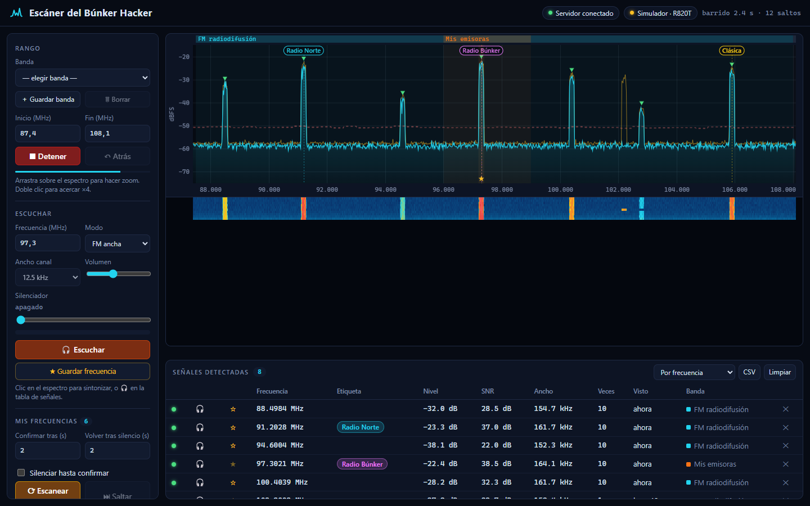
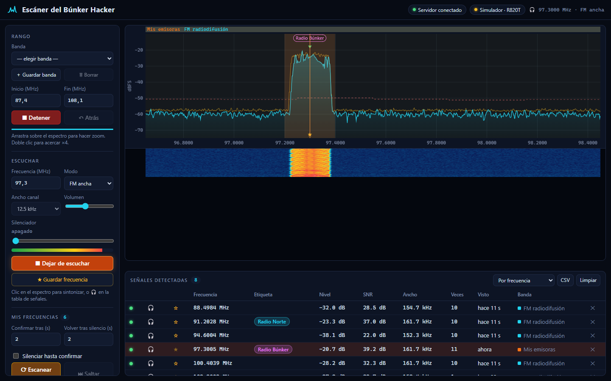
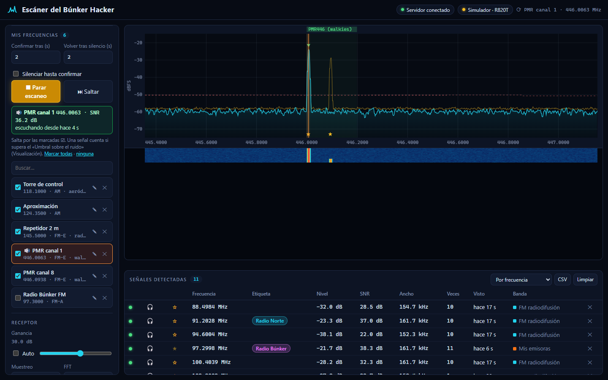
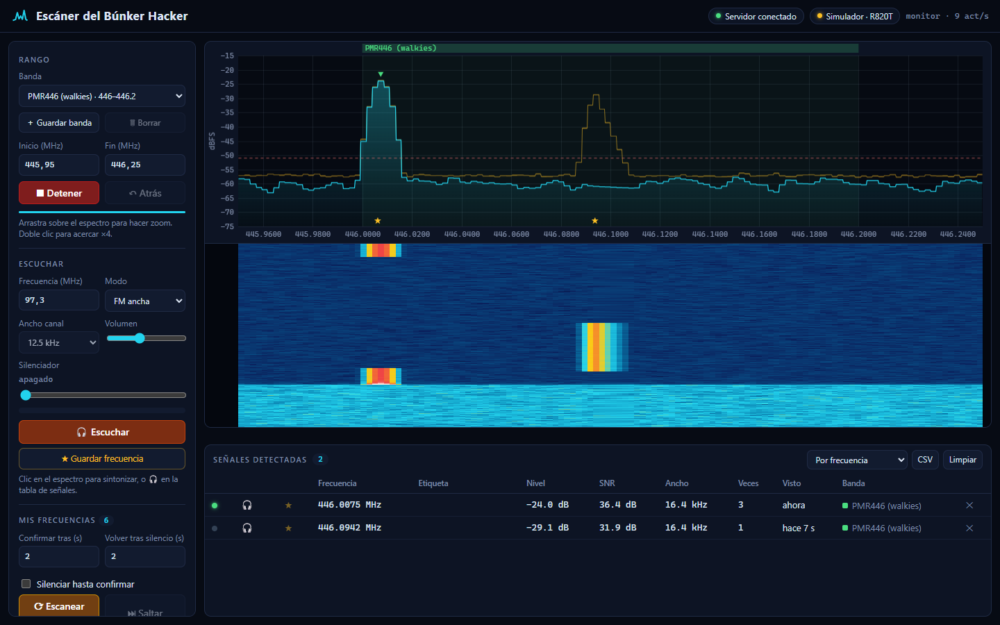

<h1 align="center">Escáner SDR de el Búnker Hacker</h1>

<p align="center">
  Escáner de frecuencias en el navegador para un dongle <b>RTL-SDR</b>:<br>
  barre bandas, muestra espectro y cascada, detecta señales y las escucha en FM y AM.
</p>

<p align="center">
  <b>🪟 Versión para Windows 10 / 11 (64 bits)</b>
</p>

<p align="center">
  
</p>

## Qué hace

- **Barrido de frecuencias** de 24 a 1766 MHz (R820T) con espectro, retención de picos y cascada.
- **Detección automática de señales** sobre el ruido, con tabla, etiquetas propias y exportación a CSV.
- **Escucha en FM ancha, FM estrecha y AM**, demodulada en el servidor y reproducida en el navegador.
- **Mis bandas** y **Mis frecuencias**: guarda rangos y canales con nombre, modo y nota.
- **Escaneo de mis frecuencias**: salta entre las marcadas, se queda en las que transmiten más de 2 s
  y vuelve a saltar cuando dejan de oírse.
- **Simulador** de `rtl_tcp` incluido para probarlo todo sin hardware.

## Capturas

| Escuchando una emisora (FM ancha) | Escaneando mis frecuencias |
|---|---|
|  |  |

| PMR446 en modo monitor con cascada |
|---|
|  |

<sub>Capturas hechas con el simulador incluido (`npm.cmd run demo`) y datos de ejemplo.</sub>

## Cómo funciona

```
RTL-SDR ──USB── rtl_tcp.exe ──TCP:1234── server.js (FFT, barrido, demodulación) ──WebSocket── navegador
```

## Requisitos

> **Esta versión es para Windows.** Está preparada y probada en Windows 11 de 64 bits
> (los scripts y la guía usan PowerShell, Zadig y `rtl_tcp.exe`).

| Qué | Detalle |
|---|---|
| Sistema | Windows 10 u 11 de **64 bits** |
| Dongle | RTL-SDR con chip RTL2832U y sintonizador R820T / R828D (RTL-SDR Blog v3/v4, genéricos «RTL2838»). Probado con R820T. |
| Antena | La del dongle sirve para empezar; una exterior o junto a una ventana mejora mucho la recepción |
| [Node.js](https://nodejs.org/) | 18 o superior (recomendado la versión LTS) |
| Driver USB | **WinUSB**, instalado con [Zadig](https://zadig.akeo.ie/) |
| `rtl_tcp.exe` | Versión de **64 bits** de [rtl-sdr-blog](https://github.com/rtlsdrblog/rtl-sdr-blog/releases) |
| Navegador | Chrome, Edge o Firefox actualizados |
| Git | Opcional, solo para clonar el repo (también puedes bajar el ZIP) |

## Instalación en Windows

Todos los comandos son para **PowerShell**, dentro de la carpeta del proyecto salvo que se diga otra cosa.

> Se usa `npm.cmd` en vez de `npm` porque Windows bloquea por defecto los scripts `.ps1` en PowerShell
> (error *«la ejecución de scripts está deshabilitada en este sistema»*). `npm.cmd` funciona sin cambiar
> ninguna configuración de seguridad. En la consola clásica (`cmd`) vale `npm` a secas.

### 1. Instala Node.js

Descárgalo de https://nodejs.org/ (LTS) o instálalo con winget:

```powershell
winget install OpenJS.NodeJS.LTS
```

Cierra y vuelve a abrir PowerShell y comprueba que responde:

```powershell
node --version
```

### 2. Descarga el proyecto e instala sus dependencias

```powershell
git clone https://github.com/elbunkerhacker/Escaner-Sdr.git
```

```powershell
cd Escaner-Sdr
```

```powershell
npm.cmd install
```

Sin Git: en GitHub pulsa **Code → Download ZIP**, descomprímelo y ejecuta `npm.cmd install` dentro de la carpeta.

### 3. Instala el driver WinUSB con Zadig

Windows no trae un driver que sirva para el RTL-SDR; hay que cambiarlo una sola vez.

1. Conecta el dongle y abre [Zadig](https://zadig.akeo.ie/).
2. Menú **Options → List All Devices**.
3. Elige **Bulk-In, Interface (Interface 0)** (USB ID `0BDA 2838`). No elijas la *Interface 1*.
4. A la derecha selecciona **WinUSB** y pulsa **Replace Driver** (o *Install Driver*).

Si ya usabas SDR# con este dongle, este paso ya está hecho.

### 4. Instala `rtl_tcp` de 64 bits

El servidor necesita `rtl_tcp.exe` en `tools\rtl-sdr-x64\`. Estos comandos descargan los binarios
oficiales de rtl-sdr-blog y copian la versión de 64 bits ahí:

```powershell
New-Item -ItemType Directory -Force tools\rtl-sdr-x64; Invoke-WebRequest https://github.com/rtlsdrblog/rtl-sdr-blog/releases/download/V1.4.0/Release.zip -OutFile $env:TEMP\rtl-sdr.zip; Expand-Archive $env:TEMP\rtl-sdr.zip $env:TEMP\rtl-sdr -Force; Copy-Item $env:TEMP\rtl-sdr\x64\* tools\rtl-sdr-x64\
```

Comprueba que ve el dongle:

```powershell
tools\rtl-sdr-x64\rtl_test.exe -t
```

Debe decir `Found 1 device(s)` y `Found Rafael Micro R820T tuner`. El aviso final
`No E4000 tuner found, aborting.` es normal con el R820T.

> **Ojo con el `rtl_tcp.exe` de SDR#** (`C:\SDRSharp\bin`): no arranca (error `0xC000007B`) porque mezcla
> un exe de 64 bits con `rtlsdr.dll` de 32 bits. Usa el de este paso.

### 5. Arranca el escáner

**La forma fácil: el icono de la bandeja del sistema.** Haz doble clic en **`Escaner SDR.cmd`**
(en la carpeta del proyecto). Aparece un icono junto al reloj de Windows (si no lo ves, mira en la flecha **^**)
y arranca `rtl_tcp` y el servidor sin abrir ninguna ventana. Clic derecho en el icono:

| Opción | Qué hace |
|---|---|
| **Abrir el escáner** | Abre http://localhost:8080 (también con doble clic en el icono) |
| **▶ Iniciar servicios** | Arranca `rtl_tcp` y el servidor web |
| **■ Detener y liberar el RTL-SDR** | Para los dos para que puedas usar el dongle en SDR# u otro programa |
| **↻ Reiniciar servicios** | Los para y los vuelve a arrancar |
| **Ver registros** | Abre la carpeta `logs\` con la salida de `rtl_tcp` y del servidor |
| **Arrancar con Windows** | Marca o quita un acceso directo en la carpeta de Inicio |
| **Detener y salir** | Para los servicios y quita el icono |

El color del icono indica el estado: **cian** en marcha, **ámbar** a medias (solo uno de los dos),
**gris** detenido y con el RTL-SDR libre. «Detener» también para un `rtl_tcp` o un servidor que hayas
arrancado a mano desde una consola.

Sin icono, desde PowerShell: `powershell -ExecutionPolicy Bypass -File bandeja.ps1 -Accion iniciar`
(o `detener`, o `estado`). `-ExecutionPolicy Bypass` solo afecta a esa ejecución; no cambia la
configuración de Windows.

**A mano, con dos consolas.** Abre **dos** ventanas de PowerShell en la carpeta del proyecto. En la primera, `rtl_tcp`:

```powershell
npm.cmd run rtl
```

En la segunda, el servidor web:

```powershell
npm.cmd start
```

Abre http://localhost:8080 y pulsa **▶ Escanear**. Para parar, `Ctrl+C` en cada ventana.

El dongle solo lo puede usar un programa a la vez: cierra SDR# u otros programas SDR antes.

### Probar sin dongle

El simulador incluido genera emisoras FM, banda aérea, PMR446, ISM 433, ADS-B, etc.:

```powershell
npm.cmd run demo
```

### Opciones del servidor

`node server.js` admite `--port 8090` (otro puerto web), `--rtl host:puerto` (rtl_tcp en otra máquina,
p. ej. una Raspberry Pi junto a la antena), `--sim` (simulador) y `--data carpeta` (dónde guardar tus
bandas, frecuencias y etiquetas; por defecto `data\`).

### Problemas frecuentes

| Síntoma | Solución |
|---|---|
| Arriba pone **«Sin rtl_tcp (127.0.0.1:1234)»** | No está abierto `npm.cmd run rtl`, o se cerró. |
| `rtl_tcp` se cierra sin mensaje o da `0xC000007B` | Mezcla de 32 y 64 bits: usa el del paso 4. |
| `usb_open error -3` / `Failed to open rtlsdr device` | Otro programa (SDR#, otro `rtl_tcp`…) ya está usando el dongle: ciérralo. Si no hay ninguno, revisa el driver (paso 3). |
| `No supported devices found` | El dongle no está conectado o le falta el driver WinUSB (paso 3). |
| Ruido muy alto (~-35 dBFS) y no aparece ninguna señal | Ganancia en «Auto» o al máximo: baja a unos 40 dB. |
| No se oye nada | Pulsa 🎧 **Escuchar** (o «🔈 Activar audio»): el navegador exige un clic para reproducir sonido. Revisa el volumen. |
| Señales «fantasma» repetidas a un salto de distancia | Sube **Asentar** a 150 ms. |
| `npm : No se puede cargar el archivo ... npm.ps1` | Escribe `npm.cmd` en lugar de `npm` (o usa `cmd`). |
| El puerto 8080 está ocupado | `node server.js --port 8090` y abre http://localhost:8090. |

## Cómo usarlo

- **Banda**: preajustes del plan de bandas (FM, aérea, PMR446, ISM 433/868, ADS-B…), o escribe inicio/fin.
  Al elegir una banda, la frecuencia de escucha pasa al centro de la banda con su modo típico
  (o el que guardaste en una banda propia); si ya estabas escuchando, se resintoniza.
- **Mis bandas**: ajusta el rango (escribiéndolo o con zoom) y pulsa **＋ Guardar banda**; ponle nombre, color
  y, si quieres, el modo de escucha (se usará al pulsar 🎧 en señales de esa banda). Aparecen arriba del
  desplegable con ★, se dibujan sobre el espectro y se guardan en `data/bandas.json`. Para borrar una,
  selecciónala y pulsa **🗑 Borrar**.
- **Etiquetas**: en la tabla de señales, clic en la columna **Etiqueta** (aparece «＋ etiqueta» al pasar el ratón),
  escribe un nombre, elige color y pulsa Enter. Para quitarla, borra el nombre y Enter; Esc cancela.
  La etiqueta se dibuja sobre el espectro, sale al pasar el ratón y en el CSV, y vuelve a aparecer cada vez
  que se detecta esa señal, aunque limpies la lista. Se guardan en `data/etiquetas.json`.
  «Etiquetadas primero» en el orden de la tabla las agrupa arriba. Con el ratón sobre la tabla, las filas
  no se reordenan solas.
- **Mis frecuencias**: tus canales favoritos, con nombre, modo, ancho y una nota opcional.
  Para guardar una, sintonízala y pulsa **★ Guardar frecuencia** (panel Escuchar), o pulsa ☆ en una fila
  de la tabla de señales (si la señal tiene etiqueta, se propone ese nombre). Clic en una frecuencia de la
  lista para escucharla; ✎ para editarla y ✕ para borrarla. Con 6 o más aparece un buscador. Se marcan
  con ★ en el eje del espectro y se guardan en `data/frecuencias.json`.
- **Escanear mis frecuencias**: marca ☑ las que quieras vigilar y pulsa **⟳ Escanear mis frecuencias**.
  Salta de una a otra; si en una hay señal por encima del «Umbral sobre el ruido» se queda
  **confirmando** y, si dura más de *Confirmar tras* (2 s por defecto), sigue **escuchando**. Cuando lleva
  *Volver tras silencio* (2 s) sin señal, continúa con la siguiente. Las ráfagas cortas (mandos, sensores)
  se descartan solas. «Silenciar hasta confirmar» evita oír esas ráfagas; **⏭ Saltar** ignora la actual
  30 s. Las frecuencias cercanas (dentro de ~±0,9 MHz) se comprueban a la vez sin resintonizar.
  Cada salto tarda lo que *Asentar* + ~10 ms: con 120 ms son unos 7 saltos por segundo.
- **Zoom**: arrastra sobre el espectro o la cascada; doble clic acerca ×4; «Atrás» vuelve.
- Si el rango cabe en un solo salto (≈1,8 MHz a 2,4 MS/s) pasa a **modo monitor**: no resintoniza y
  actualiza ~30 veces por segundo.
- **Señales detectadas**: todo lo que supera el umbral (línea roja discontinua = ruido local + umbral).
  Clic en una fila para hacer zoom. Se guardan en el navegador y se exportan a CSV.

### Escuchar (FM / AM)

- Pon la frecuencia y el modo en el panel **Escuchar** y pulsa 🎧, o pulsa 🎧 en una fila de la tabla
  (elige el modo según la banda: FM radiodifusión → FM ancha, banda aérea → AM, resto → FM estrecha).
- Con la escucha activa, un **clic en el espectro** cambia de frecuencia (se ajusta al centro de la señal
  detectada más cercana). Dentro de los ~±1 MHz capturados el cambio es instantáneo, sin resintonizar.
- Modos: **FM ancha** (radio comercial, de-énfasis 50 µs europeo), **FM estrecha** (walkies, PMR446,
  radioaficionados, marina) y **AM** (banda aérea, CB). El *ancho de canal* solo aplica a FM estrecha y AM.
- **Silenciador (squelch)**: corta el audio cuando el nivel del canal (barra de colores) está por debajo de la marca.
- Mientras escuchas, el barrido se pausa (solo hay un sintonizador) y el espectro muestra la zona sintonizada.
  «Escanear» deja de escuchar y vuelve al barrido.
- El audio se demodula en el servidor y llega a la web por WebSocket; el navegador solo lo reproduce.

### Ajustes del receptor

| Ajuste | Qué hace |
|---|---|
| Ganancia | Manual por defecto (40 dB). En «Auto» el R820T suele saturarse: el ruido sube a ~-35 dBFS y desaparecen las señales. Lo mismo a 49,6 dB. Si ves señales «espejo» o el ruido sube en toda la banda, baja la ganancia. |
| Muestreo | Ancho capturado por salto. 2,4 MS/s es lo más estable. |
| FFT | Resolución: 1024 a 2,4 MS/s ≈ 2,3 kHz/bin. Para barrer todo el rango usa 256–512. |
| Promedios | Más promedios = ruido más liso y señales débiles más visibles, pero más lento. |
| Asentar | Tiempo que se descarta tras cada resintonía. **Si aparecen señales fantasma desplazadas exactamente un salto, súbelo** (100–150 ms con hardware real). |
| Ancho útil | Fracción central de cada captura que se usa (los bordes caen por el filtro). |
| ppm | Corrección del cristal del dongle. |
| Bias-T | Alimenta una antena/LNA activa (RTL-SDR Blog v3/v4). |
